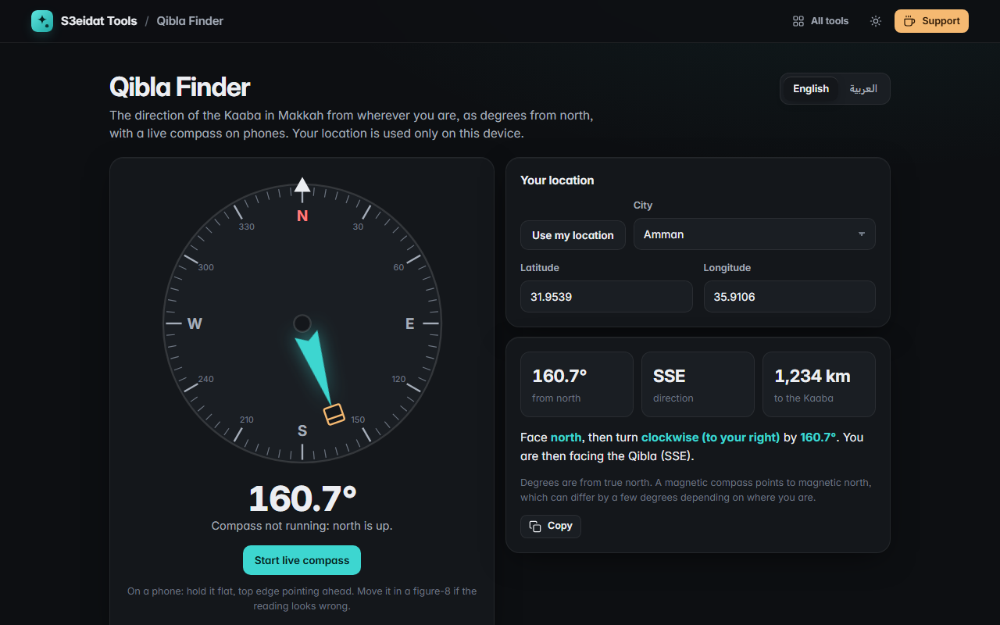

# Qibla Finder

> Find the Qibla direction from anywhere, in English and Arabic (اتجاه القبلة). Free, private, and it runs entirely in your browser.

### ▶ [Open Qibla Finder](https://s3eidat.github.io/qibla-finder/)



## Features

- **Great-circle bearing** to the Kaaba (21.4225° N, 39.8262° E) in degrees from true north, plus the compass direction (e.g. SSE) and **distance to Makkah**
- **Your location** (asked only when you click) or **manual coordinates**, plus 30+ city presets
- **Live compass** on phones using the device orientation sensor (with the iOS permission prompt and webkitCompassHeading); the dial turns and tells you how far to turn, and buzzes when you face the Qibla
- Works without any sensor: a fixed north-up dial and a plain explanation ("face north, then turn right by 160.7°")
- **Bilingual**: full Arabic (right-to-left) and English
- Honest note on true vs magnetic north

## Privacy

Your location and settings are saved only in your browser (localStorage). Coordinates and sensor readings are never sent anywhere. There is no server, no account, no analytics.
The page ships with a strict Content-Security-Policy (`connect-src 'self'`), so the browser
itself blocks any attempt to send data anywhere.

## Run it yourself

It's plain HTML, CSS and JavaScript with no build step:

```bash
git clone https://github.com/s3eidat/qibla-finder
cd qibla-finder
python -m http.server 8000
```

Then open http://localhost:8000.

## Support

If this saved you time, **[buy me a coffee ☕](https://s3eidat.github.io/coffee/)**. It keeps every tool free.

---

Part of **[S3eidat Tools](https://s3eidat.github.io/)**: 100+ free, private tools that run in your browser. MIT licensed.
